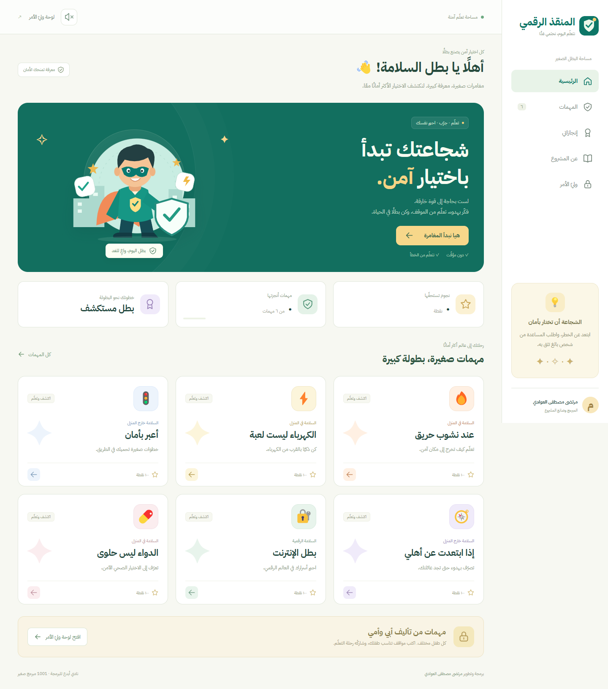
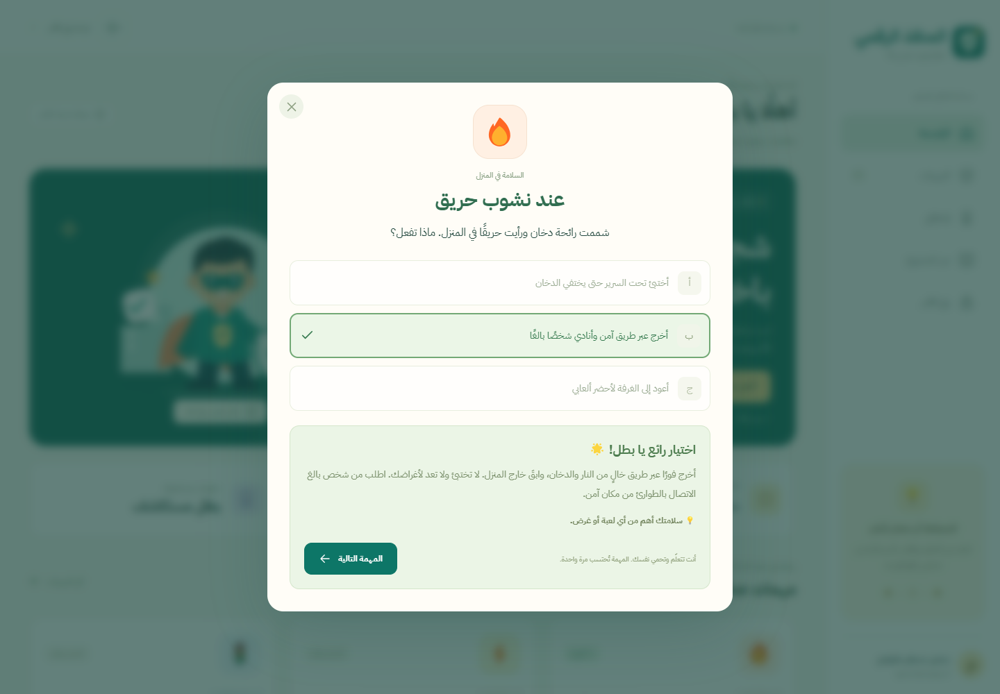
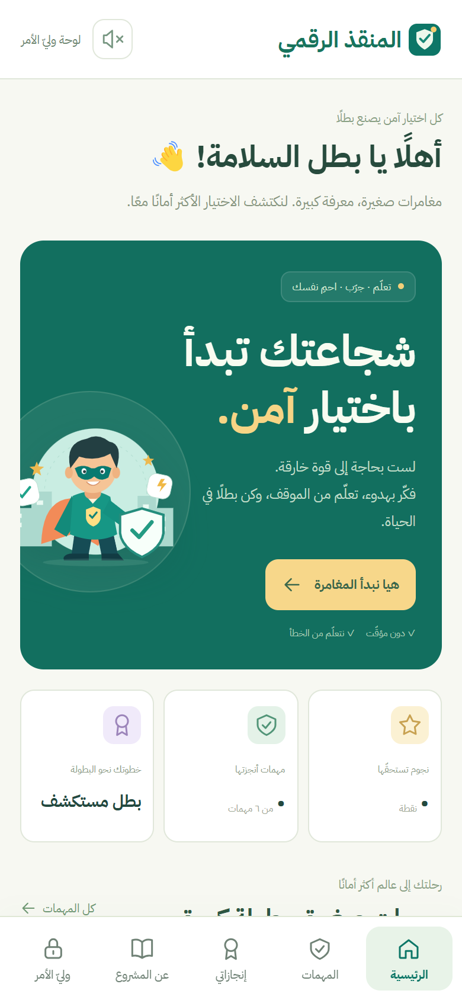
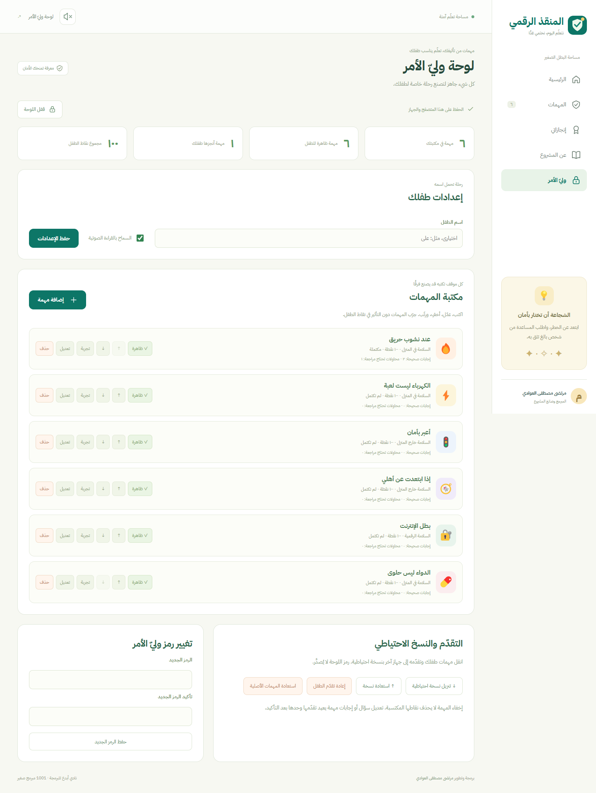
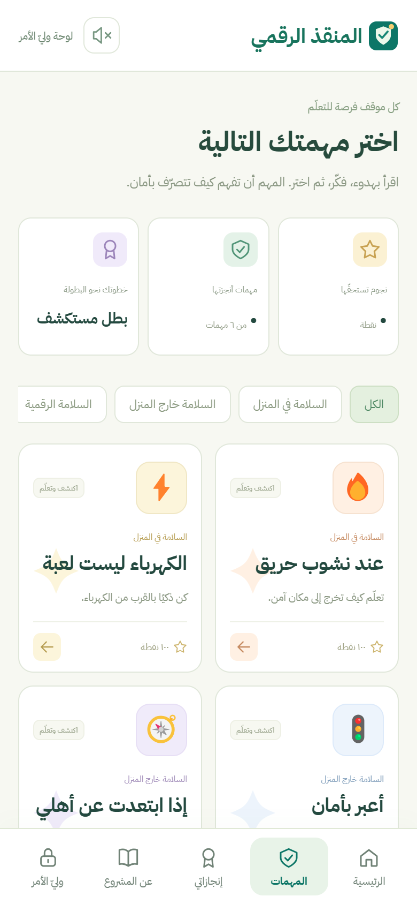

# المنقذ الرقمي

مشروع **مرتضى مصطفى العوادي** للمشاركة في تخرّج **نادي أبدع للبرمجة — 1001 مبرمج صغير**.

[افتح البرنامج](https://warithh.github.io/digital-rescuer/) · [شرح الكود لمرتضى](docs/فهم-الكود.md) · [الهدف والمميزات والتقنيات](docs/عن-البرنامج.md)



## الهدف

يهدف «المنقذ الرقمي» إلى تعليم الأطفال التصرف الآمن في المواقف الخطرة من خلال تجربة تفاعلية سهلة ومشجّعة. يعرض البرنامج موقفًا من الحياة اليومية وثلاثة خيارات، ثم يشرح التصرف الأكثر أمانًا ويسمح بالتعلّم من الخطأ دون عقوبة. يحصل الطفل على نقاط وشارات عند إكمال المهمات، بينما يشارك وليّ الأمر بإضافة مواقف تناسب طفله وتخصيصها ومتابعة تقدّمه. يجمع المشروع بين تعلّم البرمجة ونشر الوعي بالسلامة.

## المميزات

- واجهة عربية باتجاه RTL، متجاوبة مع الهاتف واللوحي والحاسوب.
- ستّ مهمات أولية عن الحريق والكهرباء والطريق والضياع والإنترنت والدواء.
- شرح لكل إجابة، وإعادة المحاولة دون خصم نقاط أو مؤقّت.
- منع احتساب نقاط المهمة أكثر من مرة، مع حفظ النقاط المكتسبة.
- لوحة محلية لوليّ الأمر برمز من 4 إلى 8 أرقام.
- إضافة وتعديل وحذف وإخفاء وترتيب المهمات وتحديد الإجابة والشرح والنقاط.
- معاينة المهمات دون تغيير تقدّم الطفل، ومتابعة المحاولات.
- اسم الطفل وإذن القراءة الصوتية، وتغيير الرمز وإعادة التقدّم.
- نسخة احتياطية متوافقة مع بيانات الإصدار السابق؛ رمز الدخول لا يُصدَّر.
- حماية البيانات التي تعذّرت قراءتها من الاستبدال التلقائي.
- موقع قابل للإضافة إلى الشاشة الرئيسية، ويعمل دون إنترنت بعد حفظ ملفاته أول مرة.
- ملف HTML مستقل يعمل دون تثبيت أو اتصال، مع خط عربي مضمّن.

## تم التنفيذ باستخدام

| التقنية | دورها |
| --- | --- |
| HTML | بناء الصفحات والنماذج والأزرار والنوافذ |
| CSS | الألوان، ترتيب العناصر، وتصميم الهاتف |
| JavaScript | الإجابات والنقاط والشاشات ولوحة وليّ الأمر |
| localStorage | حفظ المهمات والتقدّم داخل المتصفح |
| Web Crypto | حساب بصمة رمز وليّ الأمر مع salt |
| Service Worker وWeb App Manifest | تخزين الموقع للعمل دون اتصال وإضافته للشاشة الرئيسية |
| SVG | رسومات البطل والدرع والأيقونات الواضحة |
| GitHub Pages وActions | نشر الموقع وتشغيل الاختبارات تلقائيًا |

هذه النسخة لا تحتاج React أو Vite أو npm install. يحتاج إنشاء ملفات التسليم وتشغيل الاختبارات إلى Node.js 22 أو أحدث فقط. النسخة السابقة كانت تستخدم React وTypeScript؛ أعيدت كتابة النسخة الحالية بـ JavaScript المباشر لتسهيل قراءتها.

## ابدأ من هذه الملفات

```text
index.html       هيكل الصفحة
styles.css       الألوان والمسافات والهاتف
missions.js      قائمة المهمات الجاهزة
state.js         قواعد النقاط والحفظ والتحقّق
app.js           عرض الشاشات والتفاعل
assets/          الخط والرسم والأيقونات
scripts/         بناء النسخة المستقلة ومعاينة الموقع
sw.js            التخزين للعمل دون إنترنت
```

اقرأ missions.js أولًا، ثم الدالة answerMission في state.js. لا يلزم فهم لوحة الإدارة كاملة في أول تدريب.

## التشغيل

```sh
npm test
npm run build
npm run preview
```

افتح عنوان المعاينة الذي يظهر في الطرفية. ملف `standalone/المنقذ الرقمي.html` يُفتح مباشرة بالنقر المزدوج بعد البناء. `dist` هو الموقع الجاهز للنشر. الكود المنشور يبقى مقروءًا دون ضغط أو أدوات تجميع.

## الاستخدام على الهاتف

1. افتح رابط البرنامج في Chrome أو Safari.
2. في Android استخدم «تثبيت التطبيق» إن ظهر، أو «إضافة إلى الشاشة الرئيسية» من قائمة المتصفح.
3. في iPhone استخدم مشاركة ثم «إضافة إلى الشاشة الرئيسية».
4. انتظر اكتمال الفتح الأول مع الإنترنت قبل محاولة التشغيل دون اتصال.

تثبيت الموقع يختلف حسب المتصفح والجهاز. القراءة الصوتية تعتمد على وجود صوت عربي؛ بعض أصوات النظام قد تحتاج الإنترنت. التقدّم محلي لكل متصفح وجهاز ولا يتزامن تلقائيًا. لنقل البيانات استخدم النسخة الاحتياطية. تغيير عنوان الموقع أو نقل الملف إلى مسار آخر قد يتطلب استعادة النسخة.

## الصور

| الحاسوب | الهاتف |
| --- | --- |
|  |  |
|  |  |

توجد 8 صور فعلية لواجهات البرنامج داخل مجلد screenshots. الصور مُلتقطة ببيانات تجريبية، وليست بيانات أطفال حقيقية.

## ملاحظات

الرمز قفل محلي لمنع التعديل العرضي، وليس نظام حسابات أو حماية من شخص يمتلك وصولًا لأدوات المتصفح. لا تجمع النسخة الحالية بيانات الأطفال على خادم. لا تضع نسخك الاحتياطية في المستودع العام. البرنامج للتعلّم والتدريب؛ عند خطر حقيقي يبتعد الطفل عن مصدره ويطلب مساعدة شخص بالغ والطوارئ المحلية عند الحاجة.

مرجع التوعية بالحريق: [إدارة الإطفاء الأمريكية](https://www.usfa.fema.gov/gallery/pictographs/escape-planning.html).

الخط IBM Plex Sans Arabic مرخّص بـ SIL OFL؛ نص الترخيص داخل assets/FONT-LICENSE.txt.
